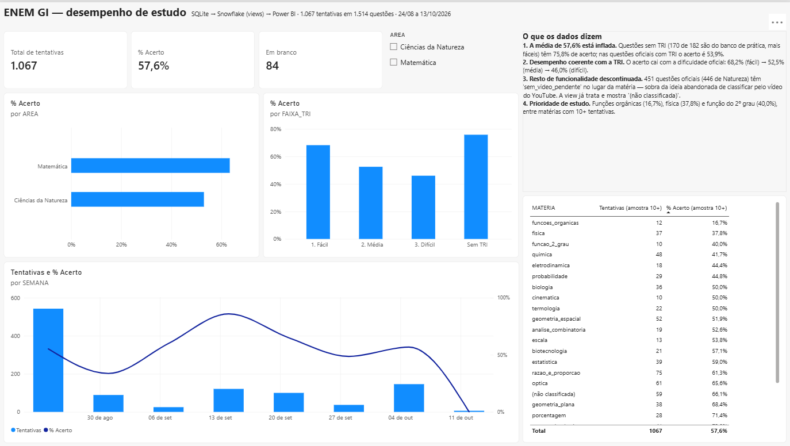

# Hi, I'm Gabriel.

`Data · Analytics · Software`

**Systems Analysis and Development** student from Serra, Brazil. I build products with data and I like finding what the numbers are hiding. Right now I'm building [**ENEM GI**](https://github.com/gbrielzin/estudos_enem), a study platform powered by official Brazilian exam data (INEP) with real users, and I'm looking for a **data internship**.

```
SQLite (app)  →  SQL Server (on-premise)  →  Snowflake (cloud)  →  Power BI
```

[](https://github.com/gbrielzin/estudos_enem#plataforma-de-dados)

<sub>Power BI dashboard on Snowflake views. Finding: my 57.6% accuracy was inflated by easier practice questions; on official questions with IRT parameters it is 53.9%.</sub>

---

### Tools

[](https://skillicons.dev)

      

---

### Projects

| Project | What's interesting about it |
|---|---|
| [**ENEM GI**](https://github.com/gbrielzin/estudos_enem) | ETL from INEP PDFs and API, authenticated API, mobile app in beta, [schema-generated data dictionary](https://github.com/gbrielzin/estudos_enem/blob/master/docs/dicionario_dados.md), the same database validated on SQL Server and Snowflake, Power BI dashboard, 190+ tests and CI |
| [**OLX Price Monitor**](https://github.com/gbrielzin/olx-monitor-intelligence) | Automated listing collection with Python + SQLite; 20k+ duplicated rows → fewer than 300 distinct listings; iPhones with battery below 80% sell for 12.5% less |
| [**Global GDP**](https://github.com/gbrielzin/analise_pib_mundial_sql_pb) | ETL in PostgreSQL and a Power BI dashboard with DAX |
| [**SQL Expense Tracker**](https://github.com/gbrielzin/controle_financeiro_sql) | PostgreSQL database of my own monthly expenses by category, with SQL queries to see where the money goes |

---

[LinkedIn](https://www.linkedin.com/in/gabriel-cardoso-santos-43b474375/) · gabrielcardosantos549@gmail.com
